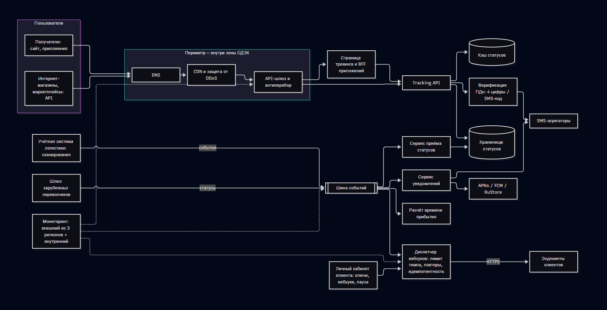

| Продукт и тип бизнеса	| Оператор доставки, прямая продажа услуги |
| :--- | :--- |
|Разбираемый ИТ-сервис	 | 	Сервис отслеживания отправления (tracking) |
|Годовой оборот и способ подтверждения	| 47,8 млрд руб, https://www.cdek.ru/ru/press/view/2026-04-07-vyrucka-sdek-po-itogam-2025-goda-vyrosla-na-14/?utm_referrer=https%3a%2f%2fyandex.ru%2f|
|Пользователи и нагрузка	 | Получатели, отправители, интернет-магазины через API,  По данным на 2025г. - 123-150 млн отправлений 9,3 млн активных пользователей по данным 2023г. 1.2 млрд запросов в год ==> 3,29 млн запросов в сутки|
|Режим данных	| 	Персональные, 152-ФЗ; статус отправления доступен без авторизации, персональные данные получателя — только после подтверждения|

## 1. Сервис и типы обращений

### 1.1. Как определяется тип обращения

Тип определяет система обращений (ITSM) по ответам оператора первой линии и по правилам мониторинга. Проверки идут строго в таком порядке:

| Шаг | Вопрос | Если «да» | Признак |
| :--- | :--- | :--- | :--- |
| 1 | Сервис работает хуже, чем обещано в SLA, или есть явная угроза этого: ошибки, недоступность, задержка статусов, неверные или пустые данные, сбой вебхуков или уведомлений, раскрытие ПДн? | **Инцидент** (1.2) | Незапланированное отклонение от целевого уровня или нормальной работы |
| 2 | Пользователь просит штатное действие, которое есть в каталоге 1.3, и ничего не сломано? | **Запрос на обслуживание** (1.3) | Действие есть в каталоге, порядок выполнения заранее известен |
| 3 | Нужно изменить код, конфигурацию, правило, лимит или компонент, и этого действия нет в каталоге? | **Запрос на изменение** (1.4) | Меняется элемент конфигурации |
| 4 | Вопрос, консультация, пожелание | Запрос SR-18 «Консультация»; пожелание по развитию — в бэклог (соответствует P4 по SLA 4.2) | — |

Пограничные случаи:

- Если клиент просит штатное действие, потому что что-то сломалось (например, «дошлите события после сбоя»), регистрируются две связанные записи: инцидент (сбой) и запрос (досылка SR-06).
- Обращение «не вижу статус по заказу X». Если событие есть в учётной системе логистики больше часа, а в трекинге его нет, это инцидент: задержка статусов, P2 по SLA 4.2. Если события нет и в учётной системе, это вне зоны ответственности сервиса (SLA, раздел 1): обращение передаётся в службу доставки, а не на вторую линию.
- Повторное обращение того же человека по тому же отправлению в течение 24 часов не создаёт новой записи и привязывается к существующей (защита от дробления, лебедь 17).
- Проблема — не обращение пользователя. Её заводит внутренняя роль по критериям 3.4.

### 1.2. Инциденты P1–P4

Ось 1 — влияние. Пользователи и доля выручки. Трекинг выручку не генерирует, поэтому «доля выручки» — это доля месячной выручки доставки (≈ 3,98 млрд руб.), приходящаяся на клиентов, чьи процессы зависят от затронутой функции. Точных данных о выручке по клиентам API у меня нет, поэтому пороги я взял оценочно, их нужно уточнить по данным коммерческой дирекции.

| Уровень | Пользователи и функции | Доля выручки доставки под влиянием | Примеры |
| :--- | :--- | :--- | :--- |
| В1 — массовое | Более 5 % запросов к API или публичному трекингу (недоступность по разделу 1 SLA); сбой подтверждён из 2–3 точек мониторинга; все клиенты API | ≥ 10 % (≥ ~400 млн руб./мес): все клиенты API или хотя бы один маркетплейс | Трекинг не отвечает; «ложный успех» > 5 %; отказ DNS/TLS |
| В2 — значительное | 1–5 % запросов; один сегмент (международные); один регион (сбой из одной точки мониторинга); все вебхуки при работающем API | 1–10 % | Задержка статусов > 1 ч; сбой вебхуков; региональная деградация |
| В3 — ограниченное | Не работает отдельная функция у группы пользователей; затронут один клиент API, который не маркетплейс и отправляет меньше 10 000 отправлений в месяц | < 1 % | Карта, история маршрута, один тип уведомлений |
| В4 — единичное | Один пользователь или заказ; косметический дефект | — | Опечатка, неверная иконка статуса |

Ось 2 — срочность.

| Уровень | Признак |
| :--- | :--- |
| С1 — высокая | Ущерб растёт с каждой минутой: клиенты запускают процессы по нашим данным, публикуются ошибочные статусы, идёт вал обращений, сейчас пиковый период (SLA 5.5) или распродажа, идёт регуляторный срок (ПДн — 24 ч) |
| С2 — средняя | Ущерб растёт медленно, часть функций работает или есть частичный обходной путь, решение может подождать несколько часов |
| С3 — низкая | Есть полноценный обходной путь, ущерб не растёт |

Матрица приоритизации

| Влияние \ Срочность | С1 — высокая | С2 — средняя | С3 — низкая |
| :--- | :---: | :---: | :---: |
| В1 — массовое | P1 | P1 | P2 |
| В2 — значительное | P2 | P2 | P3 |
| В3 — ограниченное | P2 | P3 | P3 |
| В4 — единичное | P3 | P4 | P4 |

Правила, которые важнее матрицы (автоматический P1):

1. Недоступность по критериям раздела 1 SLA, подтверждённая из двух и более точек внешнего мониторинга.
2. 50 и более однотипных обращений за 15 минут (SLA 9). Счётчик работает по признакам обращения (регион, симптом, сегмент) независимо от типа, который присвоил оператор.
3. Инцидент с внешним воздействием на клиента с объёмом более 10 000 отправлений в месяц или на маркетплейс (SLA 10.1).
4. Инцидент с персональными данными (SLA 12.1). Влияние здесь оценивается по факту раскрытия, а не по числу пользователей, а срочность задаёт 24-часовой срок уведомления регулятора.

Кто меняет приоритет. Повысить приоритет может любая роль. Понизить P1 или P2 может только менеджер инцидентов (R3), и обоснование записывается в карточку. Оператор первой линии приоритет не понижает.

Сроки по приоритетам (SLA 4.2) и внутренние цели регламента

| Приоритет | Реакция (SLA) | Решение или обходной путь (SLA) | Часы | Внутренняя цель восстановления (OLA) |
| :--- | :--- | :--- | :--- | :--- |
| P1 | 15 мин | 4 ч | 24×7 | Восстановление ≤ 18 мин от алерта (раздел 0.1) |
| P2 | 30 мин; ночью 22:00–06:00 для P2 без внешнего воздействия — 60 мин (корректировка К1) | 8 ч | 24×7 | Восстановление или обходной путь ≤ 2 ч |
| P3 | 4 рабочих часа | 3 рабочих дня | 8×5 | — |
| P4 | 1 рабочий день | По плану развития | 8×5 | — |

Для инцидентов, обнаруженных мониторингом, реакция отсчитывается от автоматической регистрации в момент срабатывания алерта. Автоматическое сообщение на статус-странице реакцией не считается: реакция — это первый содержательный ответ специалиста (глоссарий SLA).

#### Маршрутизация по линиям поддержки

| Линия | Кто | Что делает | Когда передаёт дальше |
| :--- | :--- | :--- | :--- |
| L0 — автоматизация | Мониторинг, авто-восстановление, статус-страница, личный кабинет клиента | Автоматически регистрирует инциденты по алертам, откатывает релиз при сбое после выкладки, переключает резервы, выполняет запросы самообслуживания | P1 — дежурный вызывается сразу и параллельно с авто-восстановлением. P2 ночью — если авто-восстановление не помогло за 25 мин |
| L1 — первая линия | Внешний контакт-центр (получатели, внутренний контур), персональный менеджер (клиенты API) | Регистрирует обращение, задаёт три вопроса о влиянии, привязывает его к открытому инциденту, даёт обходное решение из базы известных ошибок, информирует | P1/P2 — сразу (≤ 5 мин от начала контакта, автоматически по приоритету). P3 — если не решено по скрипту за 30 мин |
| L2 — дежурный инженер | Пул из 6 инженеров (2 SRE + 4 backend) | Диагностирует по runbook, восстанавливает (откат, переключение), выполняет стандартные изменения | P1 не локализован за 30 мин; P2 не решён за 4 ч; нужна правка кода — сразу |
| L3 — эксперты | Backend, frontend/mobile, ведущий SRE, поставщики (CDN, SMS-агрегатор) | Исправляет код, проводит глубокую диагностику, готовит срочные изменения | — |
| L4 / L5 | Руководитель ИТ-направления / ИТ-директор | Управленческая эскалация по SLA 9 | P1 — 1 ч → L4, 2 ч → L5 и клиентские коммуникации, 4 ч → решение о чрезвычайных мерах и внеочередной пересмотр SLA (SLA 11) |

Если дежурный L2 не подтвердил вызов за 5 минут, вызов автоматически уходит резервному: днём и вечером — резервному инженеру, ночью — дежурному менеджеру инцидентов (корректировка К5). Дальше вызов идёт руководителю ИТ-направления.

#### Порядок оповещения

| Кого | P1 | P2 | P3 | P4 | Кто оповещает |
| :--- | :--- | :--- | :--- | :--- | :--- |
| Дежурный L2 | Сразу, звонок | Сразу (ночью без внешнего воздействия — после 25 мин авто-восстановления) | В рабочее время, очередь ITSM | Очередь ITSM | Автоматически |
| Менеджер инцидентов (R3) | Сразу, звонок, параллельно с L2 | Сообщение ≤ 30 мин | — | — | Автоматически |
| Статус-страница | Авто-сообщение сразу; содержательное обновление ≤ 15 мин | Авто-сообщение сразу; обновление ≤ 30 мин | Если затронута публичная функция — ≤ 1 рабочего дня | — | R3 (P1), L2 (P2) |
| Технический контакт клиента API | ≤ 30 мин (SLA 6.1); обновления каждые 60 мин (SLA 9) | ≤ 30 мин (SLA 6.1) | По запросу | — | R3 + персональный менеджер (R11) |
| Клиент при внешнем воздействии | ≤ 15 мин, обновления каждые 30 мин (SLA 10.3) | то же | — | — | R3 + R11 |
| Контакт-центр (баннер и скрипт) | ≤ 15 мин | ≤ 30 мин | ≤ 1 рабочего дня при массовых обращениях | — | R3 → куратор КЦ (R10) |
| Дирекция клиентского сервиса | ≤ 30 мин | ≤ 1 ч | Ежемесячный отчёт | — | R3 |
| Руководитель ИТ / ИТ-директор | По эскалации (1 ч / 2 ч / 4 ч) или сразу при внешнем воздействии | — | — | — | R3 |
| Ответственный за ПДн, регулятор | Инцидент с ПДн: ответственному — сразу, регулятору — ≤ 24 ч | — | — | — | R14 |

#### Жизненный цикл статусов инцидента

| Статус | Когда устанавливается | Кто | Часы SLA |
| :--- | :--- | :--- | :--- |
| Зарегистрирован | Создан L1 или мониторингом | Автоматически / L1 | Запущены часы реакции и решения |
| Классифицирован | Присвоен приоритет по матрице, указан компонент, проверен дубль | Автоматически + L1/L2 | Идут |
| Назначен | Определён исполнитель или группа | Автоматически | Идут |
| В работе | Исполнитель дал первый содержательный ответ — фиксируется время реакции | L2 / R3 | Идут |
| Ожидание клиента | Запрошены данные, доступ или подтверждение (SLA 6.4) | L2 / L3 | Остановлены |
| Ожидание поставщика | Передан подрядчику (CDN, SMS-агрегатор, облако) | L2 | Идут: подрядчики находятся внутри зоны ответственности (SLA, раздел 1) |
| Восстановлен | Работа восстановлена решением или обходным путём, мониторинг в норме — фиксируется время решения | L2 / L3 | Остановлены |
| Закрыт | Выполнен критерий закрытия | R3 (P1/P2), L1 (P3/P4) | — |
| Объединён | Дубль привязан к основному инциденту | Автоматически / L1 | Отдельно не считается |
| Отменён | Ложное срабатывание, подтверждённое данными мониторинга | L2 с обоснованием | Не считается; попадает в разбор ложных срабатываний (П-14) |

Критерий закрытия инцидента. Закрыть инцидент можно, когда выполнены все условия:

1. Для P1/P2 метрики мониторинга в норме не менее 30 минут; для P3 нет новых обращений с тем же симптомом в течение 1 рабочего дня.
2. Для P3/P4 заявитель подтвердил решение или не ответил за 3 рабочих дня (SLA 6.4). Для P1/P2 подтверждение не требуется: достаточно метрик и уведомления клиентов о восстановлении.
3. На статус-странице опубликовано «Решено».
4. Для P1, инцидентов с внешним воздействием и повторяющихся инцидентов создана и связана запись о проблеме (3.4).
5. Для инцидентов с внешним воздействием опубликованы корректирующие события (≤ 1 ч, SLA 10.2) и завершена досылка.
6. Заполнены поля: время начала и восстановления, недоступные минуты (для расчёта SLA), компонент, предварительная причина.
7. 
### 1.3. Каталог запросов на обслуживание

Сроки каталога не противоречат SLA: если срок задан в SLA, он перенесён без изменений и указан в скобках.

| Код | Запрос | Кто подаёт и через какой канал | Исполнитель | Согласование | Срок | Автоматизация |
| :--- | :--- | :--- | :--- | :--- | :--- | :--- |
| Клиенты API (Tier 1) | | | | | | |
| SR-01 | Подключение к API: выпуск ключа, регистрация технического контакта и пропускной способности эндпоинта (SLA 10.4) | Клиент, личный кабинет | Автоматически + персональный менеджер | Наличие действующего договора доставки — персональный менеджер | 1 рабочий день | Ключ выдаётся автоматически после проверки договора |
| SR-02 | Ротация или отзыв API-ключа | Клиент, личный кабинет | Автоматически | Не требуется | ≤ 5 мин, 24×7 | Полностью |
| SR-03 | Изменение адреса вебхука и темпа отправки в пределах 50 событий/с (SLA 10.2) | Клиент, личный кабинет | Автоматически | Не требуется | ≤ 15 мин, 24×7 | Полностью |
| SR-04 | Повышение лимита вебхуков выше 50 событий/с или лимитов API | Клиент через личный кабинет или персонального менеджера | SRE (R7, днём) | Ведущий SRE — оценка ёмкости | 3 рабочих дня | Частично |
| SR-05 | Пауза и возобновление приёма вебхуков, события хранятся ≥ 72 ч (SLA 10.2) | Клиент, личный кабинет или API | Автоматически | Не требуется | Немедленно, 24×7 | Полностью |
| SR-06 | Досылка накопленных событий или повтор за период | Клиент через персонального менеджера или личный кабинет; автоматически после сбоя | Дежурный L2 | Уведомление клиента ≥ 30 мин до начала; клиент может снизить темп или отложить (SLA 10.3) | Старт не раньше чем через 30 мин после уведомления; подготовка ≤ 4 ч | Темп ≤ 2× среднего за 7 дней выставляется автоматически |
| SR-07 | Тестовое событие вебхука | Клиент, личный кабинет | Автоматически | Не требуется | Немедленно | Полностью |
| SR-08 | Уведомление о распродаже или акции (SLA 6.2) | Клиент, ≥ 10 рабочих дней до начала | Менеджер уровня сервиса (R2) + SRE | — | Регистрация — 1 рабочий день; оценка ёмкости и включение в календарь моратория — 5 рабочих дней | Календарь — автоматически |
| SR-09 | Выгрузка истории статусов по списку заказов (до 10 000) | Клиент через персонального менеджера | Автоматически | Не требуется | 1 рабочий день | Полностью |
| SR-10 | Отчёт по инциденту или копия разбора P1 | Клиент | Менеджер проблем (R5) | — | 5 рабочих дней после закрытия P1 (SLA 7.2) | — |
| SR-11 | Сервисный кредит за период, не учтённый автоматически (SLA 8.2) | Клиент, ≤ 30 календарных дней после месяца | R2 | Владелец сервиса (R1) | 15 рабочих дней, при споре — до 30 (SLA 8.2) | Расчёт — автоматически по внешнему мониторингу |
| SR-12 | Возмещение прямых расходов при внешнем воздействии (SLA 10.5) | Клиент, ≤ 30 календарных дней после устранения | R2 + юрист | R1; сумма больше месячной стоимости услуг клиента не возмещается | 20 рабочих дней (SLA 10.5) | — |
| SR-13 | График дежурств на пиковый период (SLA 6.1) | Публикуется проактивно; по запросу — повторная выдача | Владелец сервиса (R1) | — | Публикация ≥ 10 рабочих дней до 15 ноября; по запросу — 1 рабочий день | — |
| Получатели и отправители (Tier 2) | | | | | | |
| SR-14 | Показ персональных данных получателя после подтверждения (4 последние цифры телефона или SMS-код, SLA 2.1) | Пользователь, сайт или приложение | Автоматически | — | Немедленно | Полностью |
| SR-15 | Повторная отправка SMS-кода, подписка на уведомления и отписка от них | Пользователь, сайт, приложение или КЦ | Автоматически | — | Немедленно | Полностью |
| SR-16 | Снятие ошибочной блокировки защиты от перебора; белый список IP для партнёра | КЦ или персональный менеджер | Дневной дежурный L2 | Белый список — специалист ИБ (R14) | Снятие блокировки — 1 рабочий день; белый список — 3 рабочих дня | — |
| SR-17 | Запрос субъекта ПДн: сведения об обработке, уточнение, блокирование | Письменно | Ответственный за ПДн (R14) | Юрист | 10 рабочих дней с возможностью продления на 5 с уведомлением субъекта (ст. 14, 20 152-ФЗ) | — |
| SR-18 | Консультация по статусу и работе трекинга | КЦ, чат, e-mail | Оператор L1 по скрипту | — | В ходе контакта; если вопрос вне скрипта — 1 рабочий день (P4) | Ответы-подсказки из базы знаний |
| Внутренние запросы | | | | | | |
| SR-19 | Доступ сотрудника к мониторингу и логам | ITSM | SRE | Руководитель; для логов с ПДн — R14 | 1 рабочий день | — |
| SR-20 | Включение инженера в график дежурств или исключение из него | ITSM | Владелец сервиса (R1) | — | Не позднее 5 рабочих дней до начала периода графика | — |
| SR-21 | Баннер известной ошибки и изменение скрипта КЦ | Менеджер инцидентов или менеджер проблем | Куратор КЦ (R10) → подрядчик КЦ | — | Баннер при P1/P2 — 15 мин; изменение скрипта — 2 рабочих дня | Баннер публикуется из ITSM автоматически |

Правила согласования. Запросы без согласования выполняются автоматически или исполнителем сразу. Если запрос требует согласования, исполнитель ждёт его не дольше 1 рабочего дня. Время ожидания согласования входит в срок каталога, если согласующий — сотрудник СДЭК, и не входит, если ждём клиента (как остановка часов в SLA 6.4).

Что автоматизировано. SR-02, SR-03, SR-05, SR-07, SR-09, SR-14, SR-15 выполняются полностью без участия человека. В SR-01, SR-06, SR-08, SR-11 и SR-21 автоматизирована часть шагов. Автоматизация в первую очередь закрывает то, что нужно 24×7: так ночью не нужен инженер для штатных действий.

### 1.4. Запросы на изменение

| Категория | Признак | Кто принимает решение | Примеры |
| :--- | :--- | :--- | :--- |
| Стандартное (предодобренное) | Низкий риск, повторяемое, есть проверенная инструкция и автоматический откат; включено в перечень ниже | Решение о допуске в перечень принял комитет изменений (CAB) один раз. Дальше исполнитель (L2/R15) выполняет само изменение без согласования, с записью в журнал | Сертификаты, масштабирование, откат релиза |
| Обычное малое | Сумма баллов риска 3–5 | Два согласующих: ведущий SRE (техника) + тимлид backend (код). Срок решения — 1 рабочий день | Новая версия сервиса с изменением конфигурации, новая проверка мониторинга |
| Обычное крупное | Сумма баллов риска ≥ 6, или работы с перерывом обслуживания (SLA 5), или изменение контракта API или вебхуков, или изменение обработки ПДн | CAB: менеджер изменений (председатель), владелец сервиса, ведущий SRE, тимлид backend; при ПДн — R14; при изменении интерфейса получателя — представитель Дирекции клиентского сервиса (SLA 6.3). Заседание еженедельно по вторникам | Миграция БД, изменение формата вебхуков, плановые работы в окне |
| Изменение в мораторий | Любое изменение клиентского контура с 15.11 по 10.01 или за 3 дня до уведомлённой распродажи и во время неё, кроме исключений SLA 5.5 | Только письменное решение ИТ-директора (SLA 5.5), выкладка для ограниченного круга клиентов, в рабочее время, после регрессионной проверки (SLA 10.2) | Функциональность для крупного клиента в пик |
| Срочное (аварийное) | Нужно для устранения P1/P2 или уязвимости; ждать CAB нельзя | ECAB: менеджер инцидентов + ведущий SRE (ночью — дежурный L2 + дежурный менеджер инцидентов). Если инцидент длится дольше 4 ч — ИТ-директор. Запись в журнал ≤ 1 рабочего дня, разбор на ближайшем CAB | Hotfix, срочная блокировка уязвимости |

Перечень стандартных изменений

| Код | Изменение | Условие |
| :--- | :--- | :--- |
| SC-01 | Обновление TLS-сертификатов | Автоматически, за 14 дней до истечения |
| SC-02 | Горизонтальное масштабирование в пределах квоты | Автоматически или вручную по runbook |
| SC-03 | Правила защиты периметра (лимиты, блокировка IP) по шаблону | Шаблон согласован с ИБ |
| SC-04 | Откат релиза на предыдущую версию или выключение функции флагом | Всегда разрешено, в том числе в мораторий (SLA 5.5) |
| SC-05 | Переключение на резервную площадку или резервного SMS-агрегатора | По runbook |
| SC-06 | Добавление или изменение проверок и правил алертинга | Нельзя отключать правила, которые автоматически создают P1 |
| SC-07 | Изменение лимита вебхуков клиента в пределах 50 событий/с | По запросу SR-03/SR-04 |
| SC-08 | Поэтапная выкладка релиза без миграции БД и без изменения контракта API или вебхуков | CI пройден, включая регресс идемпотентности и порядка событий (SLA 10.2); сначала на 5 % трафика; автоматическая остановка при росте ошибок; пн–чт 10:00–16:00; не в мораторий |
| SC-09 | Перевод сегмента в режим «приостановлено» (явный статус вместо пустого ответа, SLA 1 «Отказ сегмента») | При отказе сегмента или предписании регулятора |

Оценка риска изменения. Баллы складываются.

| Фактор | Баллы |
| :--- | :---: |
| Затрагивает API или вебхуки клиентов | +3 |
| Затрагивает ПДн или передачу данных перевозчикам | +3 |
| Нет автоматического отката за ≤ 15 мин | +3 |
| Миграция данных или схемы БД | +2 |
| Не проверено на стенде или нет регресса | +2 |
| Выкладка за 3 дня до распродажи или моратория | +2 |
| Зависит от подрядчика | +1 |

0–2 балла — может быть стандартным; 3–5 — обычное малое; 6 и больше — обычное крупное (CAB). Изменение без плана отката не рассматривается, независимо от баллов.

Окна развёртывания.

- Изменения без перерыва в обслуживании (SLA 5.7): пн–чт, 10:00–16:00. Пятница, вечер и ночь исключены: так меньше ночных вызовов из-за свежих выкладок.
- Работы с перерывом: окно 02:00–05:00 в ночи пн→вт, вт→ср, ср→чт (SLA 5.3). Не больше 2 ч за сессию, не больше 2 сессий и 4 ч в месяц, не больше одной сессии в месяц с полным перерывом API (SLA 5.4). Уведомление — за 14 календарных дней для API и за 5 рабочих дней для публичного трекинга (SLA 5.2).
- Мораторий: 15.11–10.01 и распродажи (SLA 5.5).

План отката обязателен для каждого изменения. В нём указаны:

1. Способ отката: флаг, предыдущая версия или обратная миграция. Для БД действует принцип «расширить — перенести — сузить», чтобы старая версия работала с новой схемой.
2. Время отката (норма ≤ 15 мин).
3. Точка невозврата для работ в окне: конец заявленного окна минус время отката минус 10 минут запаса. Если к этой точке работы не завершены, начинается откат. Так работы заканчиваются внутри окна, и время не засчитывается как простой (SLA 5.4, 5.6).
4. Проверка после отката: какие метрики должны вернуться в норму.

## 2. Окружение сервиса

### 2.1. Компоненты и связи

| Компонент | Назначение | Чем грозит его отказ | Владелец (роль) |
| :--- | :--- | :--- | :--- |
| DNS, CDN, защита от DDoS | Точки входа | Полная недоступность — В1 | SRE (R7), договор — R13 |
| API-шлюз, антиперебор | Маршрутизация, лимиты, проверка «человек или робот» | Недоступность или ложные блокировки | SRE |
| Страница трекинга, BFF приложений | Публичный трекинг (Tier 2) | Недоступность Tier 2 | Frontend/mobile (R8) |
| Tracking API | Выдача статусов (Tier 1) | Недоступность Tier 1 | Backend (R8) |
| Кэш и хранилище статусов | Данные о статусах | «Ложный успех», пустые ответы | Backend + SRE |
| Шина событий, сервис приёма статусов | Доставка событий от учётной системы | Задержка статусов > 1 ч — P2 | Backend |
| Диспетчер вебхуков | Отправка событий клиентам | Сбой вебхуков (P2) или внешнее воздействие (P1) | Тимлид backend |
| Сервис уведомлений | Формирование push и SMS | Деградация (P3/P2) | Backend |
| Верификация ПДн | Показ ПДн после подтверждения | Инцидент с ПДн (P1) | Backend + R14 |
| Шлюз зарубежных перевозчиков | Обмен статусами по международным отправлениям | Отказ сегмента, регуляторный риск | Backend + R14 + R13 |
| Расчёт времени прибытия | Прогноз даты доставки | Некритичная функция (P3) | Backend |
| Личный кабинет клиента | Самообслуживание (SR-02, SR-03, SR-05) | Клиент не может поставить вебхуки на паузу | Backend |

### 2.2. Поставщики и их обязательства

| Поставщик | Что даёт | Чего требует от него регламент (в договоре или OLA) | Как это влияет на SLA |
| :--- | :--- | :--- | :--- |
| Учётная система логистики (внутреннее подразделение СДЭК) | События сканирования | OLA: передача события в шину ≤ 5 мин (p95), оповещение о своих сбоях ≤ 15 мин | Отсюда начинается зона сервиса (SLA, раздел 1); без OLA нельзя удержать порог «задержка статусов ≤ 1 ч» |
| Инфраструктура ЦОД (внутреннее подразделение) | Серверы, сеть, площадки | OLA: восстановление площадки или переключение ≤ 15 мин | Входит в бюджет простоя 21,6 мин |
| CDN и защита от DDoS (внешний подрядчик) | Точки входа | Доступность в договоре не ниже 99,95 %, реакция поддержки на критический сбой ≤ 15 мин 24×7, уведомление о плановых работах ≥ 14 дней | Подрядчик внутри зоны: его сбой — наш простой (SLA, раздел 1; 5.9) |
| SMS-агрегаторы (два, основной и резервный) | Приём SMS для уведомлений и кодов | Доступность приёма ≥ 99,9 %, переключение на резервного — автоматически | Зона заканчивается приёмом сообщения агрегатором |
| APNs, FCM, RuStore | Доставка push | Договорных обязательств нет | Вне зоны (SLA, раздел 1) |
| Зарубежные перевозчики | Статусы международных отправлений | Дополнительное соглашение о ПДн, минимизация передаваемых данных; сроки передачи статусов — по возможности | Сроки — вне зоны; законность передачи ПДн — внутри зоны (SLA 6.1) |
| Внешний контакт-центр | Первая линия 24×7 для получателей | Работа в ITSM СДЭК, классификация по вопросам о влиянии, передача P1/P2 ≤ 5 мин, объединение дублей (1.1, П-1) | Первая линия 24×7 (SLA 4.2); от неё зависит правило «50 обращений за 15 мин» (SLA 9) |
| Внешний сервис синтетического мониторинга | Проверки из Москвы, Новосибирска, Хабаровска | Собственная доступность ≥ 99,9 %, хранение данных ≥ 13 мес | Независимый источник при споре о доступности (SLA 7.1) |
| Дежурная служба подрядчика (резерв) | Первичная реакция ночью по инструкциям | Подключение ≤ 1 рабочего дня (SLA 6.1), только действия по runbook | Подключается, если пул дежурных меньше 5 человек |
| Магазины приложений | Распространение обновлений приложений | — | Вне зоны |

### 2.3. Каналы поступления обращений

| Канал | Кто обращается | Где регистрируется | Часы |
| :--- | :--- | :--- | :--- |
| Телефон, чат на сайте и в приложении, e-mail поддержки | Получатели, отправители | ITSM СДЭК (оператор КЦ работает в нашей системе) | 24×7 |
| Личный кабинет клиента — форма обращения | Клиенты API | ITSM, автоматически | 24×7 |
| Персональный менеджер, выделенный канал клиентов API | Клиенты API | ITSM, регистрирует менеджер | Менеджер — рабочее время; выделенный канал → дежурный — 24×7 для P1/P2 |
| Алерты мониторинга | — | ITSM, автоматически | 24×7 |
| Внутренняя форма (сотрудники ПВЗ, Дирекция клиентского сервиса) | Внутренние пользователи | ITSM | 24×7 |
| Уведомления подрядчиков (CDN, SMS, учётная система) | Поставщики | ITSM, регистрирует дежурный | 24×7 |

### 2.4. Инструменты

| Задача | Инструмент (класс) | Кто ведёт |
| :--- | :--- | :--- |
| Учёт обращений, инцидентов, проблем, изменений; база известных ошибок; каталог запросов | ITSM-система (класса Jira Service Management / Naumen Service Desk) | R2 |
| Внешний мониторинг доступности | Синтетические проверки каждые 60 с из 3 регионов | R6 |
| Внутренний мониторинг | Метрики (класса Prometheus/Grafana), логи (класса OpenSearch), трассировка | R6 |
| Вызов дежурных | Система оповещения со звонками и цепочкой эскалации (5 мин на подтверждение) | R6 |
| Статус-страница | Публичная страница с подпиской клиентов | R3 |
| Журнал изменений и работ, CMDB | В ITSM | R4 |
| Runbook и база знаний | Wiki со ссылками из алертов | R5, R6 |
| Учёт дежурств и переработок | Система оповещения + табель | R1 |

### 2.5. Точки перехода ответственности — где возникают разрывы в SLA

| Точка | Где заканчивается наша ответственность | Обязательство поставщика | Разрыв | Как закрыт в регламенте |
| :--- | :--- | :--- | :--- | :--- |
| Учётная система → шина событий | SLA действует с момента регистрации события в учётной системе | OLA ≤ 5 мин | Пока OLA нет, задержку внутри учётной системы клиент видит как нашу задержку статусов | Метрика задержки измеряется от регистрации (SLA 7.1); аномалия потока событий — P2 автоматически; OLA подписывают R1 и руководитель логистической ИТ |
| CDN и защита от DDoS | Внутри зоны: их простой — наш | Договор поставщика | Если доступность в договоре CDN ниже 99,95 %, наш SLA математически не выполним | Требование в договоре ≥ 99,95 % (R13); резервный путь DNS → напрямую к шлюзу (SC-05) |
| SMS-агрегатор | Приём сообщения агрегатором | Договор | Отказ приёма засчитывается нам | Второй агрегатор, автоматическое переключение (SC-05) |
| Эндпоинт клиента | Ответ 2xx или 24 ч повторов | Нет (обязательства клиента — SLA 10.4) | Перегрузка клиента нашей досылкой — внешнее воздействие (SLA 10) | Лимит темпа, автоматическое отключение, уведомление за 30 мин (П-17) |
| Зарубежный перевозчик | Сроки статусов — вне зоны, законность ПДн — внутри | Дополнительное соглашение | Предписание регулятора останавливает сегмент, и это наш простой (SLA 12.4) | Минимизация данных, режим «приостановлено» (SC-09), раздел 8.1 |
| Контакт-центр подрядчика | Первая линия — по SLA наша | Договор на год, заключён без участия эксплуатации | Ошибочная классификация срывает реакцию 15 мин; дробление обращений искажает отчётность и счётчик «50 за 15 мин» | Классификация в ITSM, а не оператором; объединение дублей; куратор (R10); раздел 9.1 |
| Внешний мониторинг | Источник данных для SLA | Договор | Без его данных нечем подтвердить доступность при споре | Внутренний мониторинг как резервный источник, проверка «пульса» мониторинга |
| Дежурная служба подрядчика | Действует только по runbook | Договор | Не может чинить код | Только действия SC-04/SC-05/SC-09; L3 — наши инженеры |

## 3. Практики ITIL 4

Я взял обязательные пять практик и service level management, а к ним добавил ещё две. Для каждой указал, какой параметр SLA без неё не удержать.

| Практика | Без неё не удержать | Владелец практики | Процедуры |
| :--- | :--- | :--- | :--- |
| Incident management | Реакция и решение P1–P4 (SLA 4.2), эскалация (SLA 9), уведомления (SLA 6.1, 10.3) | Менеджер инцидентов (R3) | П-1 – П-8 |
| Service request management | Пауза вебхуков, досылка, лимиты (SLA 10.2–10.4), сроки 8.2 и 10.5 | Сервис-менеджер как владелец каталога (R12) | П-17, П-22 |
| Change enablement | Плановые работы и мораторий (SLA 5), регресс вебхуков (SLA 10.2) | Менеджер изменений (R4) | П-11 – П-13 |
| Problem management | Разбор P1 за 5 рабочих дней (SLA 7.2), совместный разбор (SLA 10.6), снижение числа ночных вызовов | Менеджер проблем (R5) | П-9, П-10 |
| Monitoring and event management | Доступность 99,95/99,9 % и её измерение (SLA 4.1, 7.1), авто-регистрация инцидентов | Ответственный за мониторинг (R6) | П-14 |
| Service level management | Отчёт до 5-го рабочего дня, кредиты, пересмотр (SLA 7.2, 8, 11) | Менеджер уровня сервиса (R2) | П-15, П-16 |
| Доп.: Supplier management | Доступность 99,95 % при подрядчиках внутри зоны (SLA, раздел 1; 5.9), первая линия 24×7 (SLA 4.2), законность передачи ПДн перевозчикам (SLA 6.1) | Менеджер поставщиков (R13) | П-19 |
| Доп.: Information security management | Показ ПДн только после подтверждения и защита от перебора (SLA 2.1); 24/72 ч по инцидентам с ПДн (SLA 12.2) | Ответственный за ПДн и ИБ (R14) | П-18 |

### 3.1. Incident management

Раскрыто в 1.2: критерии приоритетов и матрица, маршрутизация L0–L5, порядок оповещения, жизненный цикл, критерий закрытия. Ключевые принципы:

- Сначала восстановить, потом разбираться: внутренняя цель для P1 — 18 мин от алерта (раздел 0.1).
- Один инцидент — одна запись: обращения привязываются к основному инциденту, а не размножаются.
- Роли при P1 разведены: дежурный L2 чинит, менеджер инцидентов координирует и общается с клиентами. Один человек одновременно эти роли при P1 не выполняет.

### 3.2. Service request management

Каталог, сроки, согласования и автоматизация — в 1.3. Владелец каталога (R12) раз в квартал проверяет, какие запросы чаще всего выполняются вручную, и ставит их в план автоматизации. Цель — чтобы ночью не требовался человек для штатных действий.

### 3.3. Change enablement

Категории, полномочия, оценка риска, окна и откат — в 1.4. Менеджер изменений ведёт календарь изменений с отметками моратория, распродаж (SR-08) и лимитов SLA 5.4, чтобы до согласования было видно, не превышен ли лимит сессий в месяце.

### 3.4. Problem management

Отличие от инцидента. Инцидент — это симптом, и его цель — быстро восстановить работу любым способом, в том числе откатом. Проблема — это причина одного или нескольких инцидентов, и её цель — устранить причину, чтобы инцидент не повторился. Инцидент закрывается, когда работа восстановлена. Проблема закрывается, когда причина устранена изменением и симптом не повторяется 30 дней.

Критерии заведения проблемы (любой из них):

1. Каждый P1 и каждый инцидент с внешним воздействием — обязательно.
2. Три и более инцидента с одним симптомом или компонентом за 30 дней.
3. P2 дольше 4 часов.
4. Ночной вызов, повторившийся дважды за 14 дней.
5. Тренд мониторинга, ведущий к нарушению SLA (проактивно), например растущая задержка статусов.
6. Кластер жалоб в КЦ без открытого инцидента — по сигналу куратора КЦ (R10).

Методы анализа причин.

| Ситуация | Метод |
| :--- | :--- |
| Единичный сбой с понятной цепочкой | Хронология + «5 почему» |
| Несколько факторов (люди, процесс, техника, поставщик) | Диаграмма Исикавы |
| P1 с внешним воздействием | Хронология + дерево отказов + совместный разбор с клиентом (SLA 10.6) |

Разборы проводятся без поиска виноватых: вопрос не «кто ошибся», а «что в системе позволило ошибке дойти до клиента».

Известные ошибки и обходные решения. Если причина известна, но ещё не устранена, создаётся запись известной ошибки в ITSM. В ней указаны симптом, как его распознать, обходное решение, текст для скрипта КЦ, статус (открыта / исправление запланировано / закрыта) и связанное изменение. Обходное решение публикуется для первой линии не позднее 1 рабочего дня, а при активном P1 — баннером за 15 минут (SR-21). Записи пересматриваются ежемесячно: если по известной ошибке больше 3 месяцев нет изменения, вопрос выносится на квартальный пересмотр SLA (П-16).

### 3.5. Monitoring and event management

Что мониторится и пороги

| Что | Порог | Событие | Автоматический инцидент |
| :--- | :--- | :--- | :--- |
| Синтетические запросы к API и странице трекинга, 60 с, 3 региона | > 5 % ошибок 5xx или таймаутов > 10 с за минуту | Недоступная минута | P1: 2 точки и более, 2 минуты подряд. P2: 1 точка, 3 минуты подряд (региональная деградация) |
| Доля ошибок на API-шлюзе | 1–5 % в течение 5 мин | Деградация | P2 |
| Время ответа p95 на шлюзе | Выше цели (API 800 мс, страница 1,5 с — корректировка К4), но < 10 с, в течение 10 мин | Деградация | P3 днём; P2 в пик и при распродаже |
| Контрольные отправления с известным статусом (внутренние и международные) | Расхождение > 5 % всех проверок | «Ложный успех» | P1; если только один сегмент — P2 + проверка внешнего воздействия (SLA 1 «Отказ сегмента») |
| Задержка статусов: регистрация → API, p95 | > 15 мин — предупреждение; > 60 мин | Задержка | Предупреждение — дежурному в рабочее время; > 60 мин — P2 |
| Поток событий от учётной системы | Падение на 50 % от нормы для этого часа и дня недели | Аномалия источника | P2, уведомление поставщику (OLA) |
| Очередь диспетчера вебхуков | Отставание > 10 мин | Задержка вебхуков | P2 |
| Исходящий темп вебхуков на эндпоинт | Выше согласованного (по умолчанию 50 событий/с) | Риск внешнего воздействия | Автоматическое ограничение темпа; при превышении — P1 (внешнее воздействие) |
| Повторная отправка события с новым идентификатором | Любой случай | Нарушение идемпотентности | P1 (SLA 10.1) |
| Приём SMS агрегатором | > 5 % ошибок за 5 мин | Отказ агрегатора | Автоматическое переключение на резервного + P3; если отказали оба — P2 |
| Обращения в КЦ по одному признаку | ≥ 20 за 15 мин — предупреждение; ≥ 50 за 15 мин | Массовый сбой | Предупреждение — менеджеру инцидентов; ≥ 50 — P1 (SLA 9) |
| Запросы по несуществующим номерам с одного источника; всплеск попыток показа ПДн | Выше базовой линии в 5 раз | Возможный перебор | Событие ИБ → R14; при подтверждении раскрытия — P1 (инцидент с ПДн) |
| Нагрузка (запросы в секунду, ЦП, память, диски, очереди) | 70 % — предупреждение, 85 % — критично; рост среднемесячной нагрузки > 30 % | Ёмкость | 85 % — P2; рост > 30 % — триггер внеочередного пересмотра SLA (SLA 11) |
| Сертификаты | < 14 дней до истечения | Плановое событие | Стандартное изменение SC-01 |
| «Пульс» внешнего мониторинга | Нет данных 5 мин | Потеря наблюдаемости | P2, переход на внутренние данные |

Классы событий. Информационное — только в журнал. Предупреждение — в очередь дежурного, без звонка. Исключение — инцидент и вызов по таблице выше.

Борьба с ложными срабатываниями.

1. Подтверждение из нескольких точек: P1 требует 2 регионов и 2 минут подряд.
2. Гистерезис: событие закрывается, только когда метрика 5 минут ниже порога, иначе алерт «мигает».
3. Группировка: алерты одного компонента в течение 10 минут — один инцидент.
4. Подавление на время работ: на время плановых работ алерты затронутых компонентов подавляются автоматически по номеру изменения, но только на время окна.
5. Еженедельный разбор (П-14). Каждый алерт, по которому дежурный ничего не сделал, перенастраивается или удаляется. Цель: не менее 80 % ночных вызовов требуют действия человека.

### 3.6. Service level management

| Вопрос | Ответ регламента |
| :--- | :--- |
| Кто собирает фактические значения | Доступность и сегменты — ведущий SRE (R6) из внешнего мониторинга; реакция и решение — менеджер уровня сервиса (R2) из ITSM; работы — менеджер изменений (R4) из журнала; задержка статусов — R6 из внутреннего мониторинга |
| В какой форме | Ежемесячный отчёт по SLA 7.2: доступность по контурам и сегментам, инциденты по приоритетам, выполнение сроков, работы, кредиты. Плюс публичная статус-страница в реальном времени. Внутренний отчёт дополнительно содержит «бюджет недоступности», число ночных вызовов и переработки дежурных |
| Как часто | Статус-страница — постоянно; оперативная сводка — еженедельно по понедельникам; отчёт — до 5-го рабочего дня месяца; квартальный пересмотр метрик; годовой пересмотр SLA в сентябре (SLA 11) |
| Кому | Клиентам API — через личный кабинет и персонального менеджера; Дирекции клиентского сервиса (внутренний контур); комитету по уровню сервиса |
| Кто инициирует пересмотр | Менеджер уровня сервиса — по триггерам SLA 11 и по результатам регламента (раздел 7). Решение принимает владелец сервиса, а изменения внешнего SLA подписывает коммерческая дирекция |

## Лебедь 17

Ради экономии первую линию передали внешнему контакт-центру, который работает по скриптам и получает оплату за каждое обработанное обращение. Операторы регистрируют почти всё как запросы на обслуживание, не умеют оценивать влияние сбоя, и о серьёзных авариях вторая линия узнаёт в среднем через час после первых звонков. Одно обращение пользователя нередко дробится на несколько, потому что так выгоднее подрядчику. Договор с контакт-центром заключён на год, и его условия формировались без участия эксплуатации.

## Лебедь 25

Дежурные инженеры коллективно отказались от ночных вызовов на нынешних условиях: компенсация не пересматривалась несколько лет, а число ночных вызовов за год выросло втрое. Юристы, разбираясь в ситуации, выяснили, что часть дежурств оформлена с нарушением трудового законодательства, и требуют ограничить число ночных вызовов и обеспечить обязательный отдых после них. Это примерно вдвое сокращает число людей, доступных ночью, а обязательства по круглосуточной поддержке остаются прежними. Бюджета на дополнительные выплаты и найм в этом году нет.
